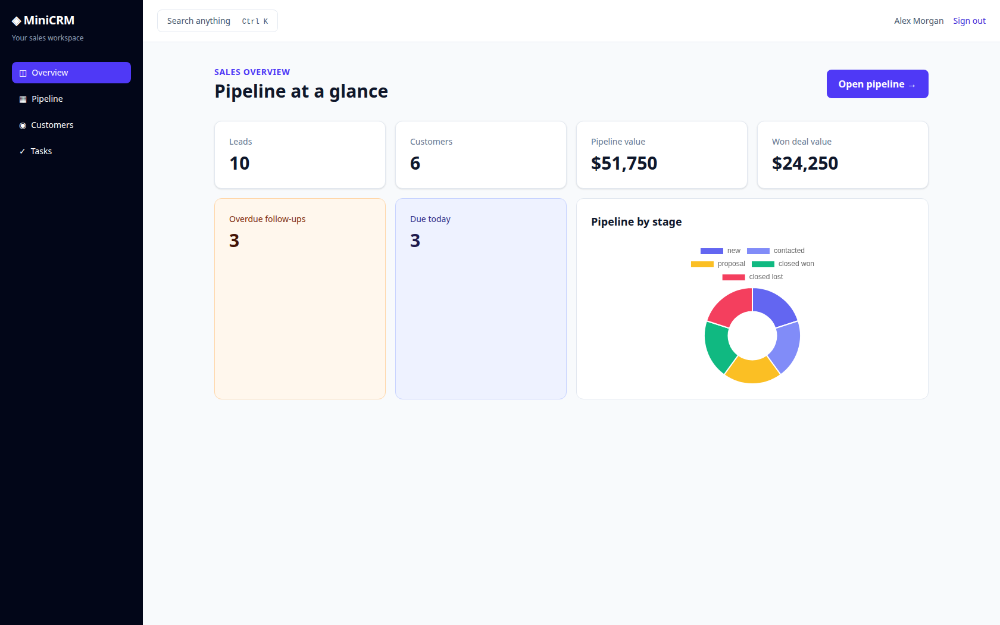
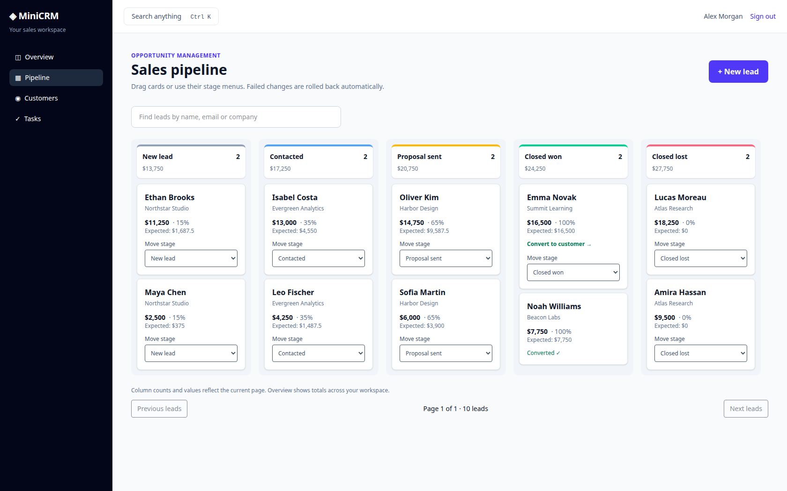
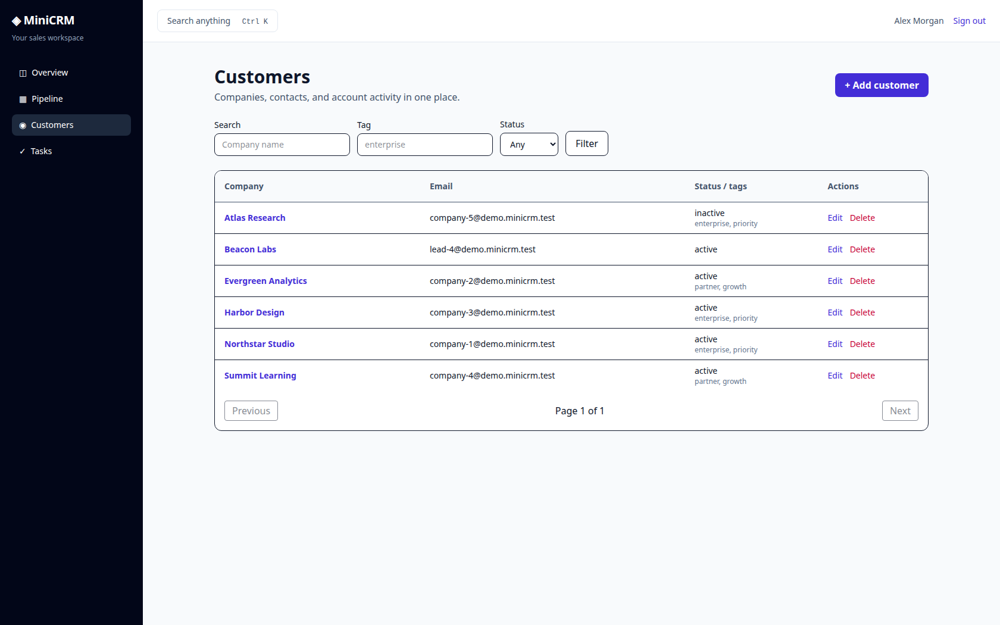
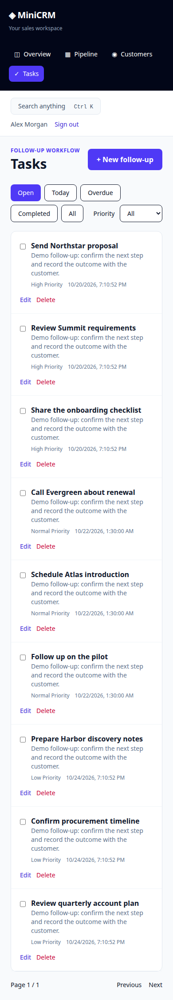

# MiniCRM · Laravel API + Vue sales workspace

A CRM built with **Laravel 13, Vue 3, Pinia, and Tailwind CSS 4**. Manage a private sales pipeline, convert prospects into customers, and track contacts and follow-ups through a session-authenticated API.



## Application features

- Registration, cookie-based Sanctum authentication, CSRF protection, rate limiting, and password recovery with expiring, single-use tokens.
- Owner isolation enforced by scoped queries and policies inside business actions.
- Five-stage sales pipeline with drag-and-drop and native keyboard-accessible stage menus.
- Server-side search and pagination, version-aware updates, and rollback of failed optimistic moves.
- Atomic one-time lead conversion that creates a customer/contact and records the activity history.
- Customer directory, tags, contact pagination, and interaction timelines.
- Follow-up tasks with priorities, due dates, overdue/today filters, and idempotent completion.
- Dashboard aggregates, pipeline chart, and Ctrl+K quick search.
- Focus-managed dialogs, mobile layouts, stale-response guards, and session-expiry feedback.
- Reusable factories and an optional repeatable demo dataset.

Each account has its own records. This version does not share customer records between teammates.

## Run with Docker Compose

Docker Engine and Compose are the only host requirements for running the app. PHP 8.4, Composer, Node 22, and frontend asset compilation run inside Docker.

```bash
git clone git@github.com:dionis1/MiniCrm.git
cd MiniCrm
docker compose up --build -d
```

Open [http://localhost:8000](http://localhost:8000). Prefix Docker commands with `sudo` if your PC requires it. Startup applies migrations; rebuilding after source changes refreshes the application image.

Compose runs one app container with a named volume for SQLite, sessions, logs, and its generated local encryption key. Docker is for local use. CI and deployment tooling are not included.

```bash
# Inspect startup:
docker compose ps
docker compose logs --tail=50 app

# Stop and release the container's RAM, preserving data:
docker compose down

# Restart:
docker compose up -d

# Use another local port:
APP_PORT=8001 docker compose up -d
```

**`docker compose down -v` deletes your local database and encryption key.**

Register your own account or add the optional demo data below. Password-reset links are written to the local log:

```bash
docker compose exec app tail -n 100 storage/logs/laravel.log
```

Keep reset links private. A real email provider is not configured.

## Demo data and factories

```bash
docker compose exec app php artisan db:seed --class=DemoSeeder
```

| Account | Email | Password |
| --- | --- | --- |
| Sales workspace | `sales@demo.minicrm.test` | `MiniCrmDemo!2026` |
| Separate private workspace | `other@demo.minicrm.test` | `MiniCrmDemo!2026` |

The sales workspace contains 10 leads across all stages, six customers (including a converted lead), 11 contacts, 12 follow-ups, and activity histories. The second account has a private lead to demonstrate isolation. Dashboard amounts and viewable records are synthetic.

Seeding calls the real actions and is transactional. Reruns preserve existing records, edited demo data, and account passwords. It never runs automatically during startup and refuses environments other than `local`/`testing`. These public credentials are for local demonstrations only. Deleted demo records may be recreated on a later seed. `php artisan db:seed` calls the same seeder.

Factories are available for `User`, `Lead`, `Customer`, `Contact`, and `CrmTask`. Use actions when a fixture also needs business validation and audit history; factories insert records directly.





## Tests and checks

```bash
# PHP/Pest regression suite; isolated in-memory database:
docker compose exec app php artisan test

# PHP formatting:
docker compose exec app vendor/bin/pint --test

# Locked PHP dependency advisories:
docker compose exec app composer audit --locked

# Frontend unit tests/build using the Node Docker stage:
docker build --target frontend -t minicrm-frontend:local .
docker run --rm minicrm-frontend:local npm run test:unit
docker run --rm minicrm-frontend:local npm audit
```

PHP tests force their test database, session, cache, mail, and encryption settings even when invoked inside the running Compose container. They never reset your personal application database.

Coverage includes ownership and direct-action policies, scoped task links, transaction rollback on contact/audit failures, stale lead versions, repeated conversion after customer deletion, idempotent task completion, pagination/filter validation, reset-token expiry/reuse, and non-destructive demo seeding. Frontend unit tests cover search/value helpers, stale requests, and local date handling across daylight-saving changes.

### Browser checks

With Node 22 and npm available on the PC, build the app image first, then:

```bash
npm ci
npx playwright install chromium
npm run test:browser

# Or use an installed Chrome:
CHROME_BIN=/usr/bin/google-chrome npm run test:browser
```

The runner starts and removes a separate Docker container on port 8010, using an internal `/tmp` database and no persistent volume. It refuses to reuse an already-running server. Browser checks cover registration, customer/task creation, keyboard stage changes, conversion/read-only states, conflict rollback, mobile focus/overflow, search beyond the first page, password-recovery screens, expired sessions, and cross-site forgery rejection. Test artifacts are written under `test-results`, independently of README screenshots.

To refresh the README images from an untouched demo workspace, run `CHROME_BIN=/usr/bin/google-chrome node scripts/capture-screenshots.mjs` while the app is running and seeded.

README screenshots use only the synthetic demo workspace. Automated checks do not replace a full manual accessibility review.

## Architecture and API

- `app/Actions`: focused invokable business operations with policies, shared validation, and transactional audit history.
- `app/Policies`: resource ownership rules enforced independently of the Vue UI.
- `app/Enums`: backed lead stages, customer statuses, and task priorities cast on models.
- `app/Http/Requests` and `app/Support/CrmRules.php`: HTTP input and shared domain constraints.
- `app/Http/Resources`: explicit JSON representations; filtered, bounded list endpoints.
- `resources/js/pages`: Vue Composition API screens; Pinia session/toast stores and Vue Router.
- `resources/js/composables/useDialog.js`: dialog focus/keyboard behavior.
- `resources/js/lib`: API handling, request ordering, pipeline helpers, and local date formatting.

See the [API contract](docs/API.md) for endpoints, payloads, pagination, and error responses. [Architecture decisions](docs/ARCHITECTURE.md) explain isolation, transaction boundaries, conversion concurrency, query choices, and limitations.

## Existing data and deliberate scope

The original `companies` and `employees` migration history is preserved. New CRM fields and indexes are additive migrations. Legacy rows with no owner stay hidden; ownership must be assigned through a reviewed data migration. Back up existing databases before applying schema changes. Never use `migrate:fresh` against real data.

The lock files resolve stable releases, including Laravel 13.38.0. SQLite is the verified local database. There is no claim of tested MySQL/PostgreSQL behavior, multi-company tenancy, shared-team roles, pushed real-time updates, or production hosting. Lead writes have optimistic concurrency; customer/contact/task edits currently use ordinary writes. Timelines show the latest 100 events. Task-link pickers show the initial bounded lead/customer results. Substring search targets small workspaces; larger installations need a deliberate search/indexing strategy.

## Mobile tasks


